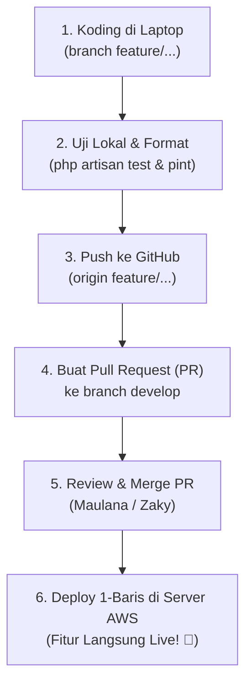

# PANDUAN DEPLOYMENT CLOUD & ALUR KERJA TIM CUCI.IN (MILESTONE 2)

**Sistem Informasi Manajemen Operasional Laundry Berbasis Web (Full Laravel MPA)**  
*D4 Sistem Informasi Bisnis — Politeknik Negeri Malang*

---

## 1. Pengumuman Rilis Server Production

Aplikasi **CUCI.IN** telah resmi aktif dan ter-deploy pada infrastruktur cloud publik dengan spesifikasi:

- **Alamat URL Utama:** [https://portal-cuciin.web.id](https://portal-cuciin.web.id)
- **Pelacakan Nota Publik (Tanpa Login):** [https://portal-cuciin.web.id/lookup](https://portal-cuciin.web.id/lookup)
- **Infrastruktur Host:** Amazon Web Services (AWS) EC2 `t3.micro` — Region Asia Pacific (`3.25.167.8`)
- **DNS & Keamanan SSL:** Cloudflare (SSL Mode: Flexible)
- **Web Server & Database:** Nginx 1.28+, PHP 8.5+, PostgreSQL 16+

---

## 2. Kredensial Akun Pengujian Tim (Demo Milestone 2)

Seluruh anggota tim dapat menguji coba fitur masing-masing langsung di server production menggunakan akun berikut (semua kata sandi: **`password`**):

| Role / Peran | Alamat Email | Nama Pengguna | Akses Halaman Utama |
| :--- | :--- | :--- | :--- |
| **Admin / Owner** | `admin@cuci.in` | Super Administrator | Dashboard Admin, Kelola Pengguna (`/admin/users`), Rekapitulasi Laporan (`/admin/reports`) |
| **Kasir / Staff** | `staff@cuci.in` | Kasir Utama | Dashboard Staf, Kasir POS (`/staff/pos`), Verifikasi Pembayaran (`/staff/payments`), Tiket Komplain (`/staff/complaints`) |
| **Pelanggan** | `customer@cuci.in` | Rina Wulandari | Dashboard Pelanggan (`/customer/dashboard`), Upload Bukti Transfer, Pengajuan Komplain |
| **Tamu Outlet** | *(Tanpa Login)* | Pelanggan Umum | Cek status cucian mandiri via nomor nota di `/lookup` |

---

## 3. Alur Kerja Pengembang (Git Workflow dari Laptop ke Server)

Agar tidak terjadi konflik kode (*merge conflict*) dan server tetap stabil, ikuti 5 langkah standar berikut:



### Langkah 1: Koding pada Cabang Fitur Sendiri
Sebelum mulai mengoding fitur baru, selalu pastikan cabang `develop` lokal kamu adalah yang paling baru:
```bash
git checkout develop
git pull origin develop
git checkout -b feature/<nama-fitur-kamu>
```

### Langkah 2: Uji Coba Lokal & Rapikan Format Kode
Sebelum melakukan komit dan push, pastikan seluruh automated test lulus dan kode terformat rapi:
```bash
# Jalankan seluruh test
php artisan test

# Format kode otomatis sesuai standar tim
vendor/bin/pint --format agent
```

### Langkah 3: Push Cabang Fitur ke GitHub
```bash
git add .
git commit -m "feat(modul): deskripsi ringkas fitur yang dibuat"
git push origin feature/<nama-fitur-kamu>
```

### Langkah 4: Buat Pull Request (PR) ke Branch `develop`
1. Buka repositori GitHub: [https://github.com/Maulanahb/CUCI.IN](https://github.com/Maulanahb/CUCI.IN).
2. Klik tombol **Compare & pull request**.
3. Pastikan target branch ditujukan ke **`develop`** (BUKAN langsung ke `main`).
4. Tulis deskripsi perubahan secara ringkas.

---

## 4. Apa yang Dilakukan Setelah Perubahan Di-Merge ke `develop`?

Begitu Pull Request berhasil di-*merge* ke cabang `develop`:

### A. Tindakan Anggota Tim (Pengirim Kode):
1. Kirim pesan singkat di grup WhatsApp tim:
   > *"Halo gaes, PR fitur [Nama Fitur] sudah di-merge ke develop ya. Tolong di-deploy ke server."*

### B. Tindakan Deployment ke Server (Dilakukan oleh Maulana / PIC Server):
1. Buka terminal server AWS EC2 (bisa via AWS Console *EC2 Instance Connect* di browser, atau via SSH).
2. Jalankan **perintah pembaruan 1 baris** berikut:

```bash
cd /var/www/cuci-in && git pull origin develop && composer install --no-dev --optimize-autoloader && php artisan migrate --force && npm install && npm run build && php artisan optimize && sudo chown -R www-data:www-data storage bootstrap/cache
```

### Apa yang Dilakukan oleh Perintah 1 Baris di Atas?
1. `git pull origin develop` $\rightarrow$ Mengunduh seluruh kode terbaru dari GitHub.
2. `composer install ...` $\rightarrow$ Memperbarui package PHP jika ada dependensi baru.
3. `php artisan migrate --force` $\rightarrow$ Menjalankan migrasi database PostgreSQL secara otomatis jika ada tabel baru tanpa menghapus data yang sudah ada.
4. `npm install && npm run build` $\rightarrow$ Mengompilasi asset Tailwind CSS & Alpine.js agar tampilan terbaru langsung aktif.
5. `php artisan optimize` $\rightarrow$ Membersihkan cache lama dan mengaktifkan cache rute serta konfigurasi production agar web merespon sangat cepat.
6. `sudo chown ...` $\rightarrow$ Memastikan folder penyimpanan file upload (bukti transfer & komplain noda) memiliki izin tulis yang benar untuk web server.

---

## 5. Menjalankan Antrean Background Job (Queue Worker P9)

Sesuai materi P9, tugas kompresi gambar dan notifikasi diproses di antrean background. Untuk memastikan worker tetap hidup di server AWS:

```bash
# Cek apakah worker sedang berjalan
ps aux | grep "queue:work"

# Jika belum jalan, jalankan di latar belakang:
nohup php /var/www/cuci-in/artisan queue:work --tries=3 --timeout=60 > /dev/null 2>&1 &
```

---

## 6. Pertanyaan Umum & Troubleshooting (FAQ)

**T: Kenapa perubahanku belum muncul di website `portal-cuciin.web.id`?**  
J: Pastikan dua hal: (1) PR kamu sudah di-merge ke branch `develop`, dan (2) Perintah deploy 1-baris di atas sudah dijalankan di terminal server AWS.

**T: Bagaimana jika ada file upload (bukti bayar/foto komplain) yang gambarnya pecah atau 404?**  
J: Pastikan symlink storage aktif di server dengan perintah `php artisan storage:link`, dan pastikan hak akses folder sudah diatur via `sudo chown -R www-data:www-data storage`.

**T: Apakah database di server akan ter-reset saat deploy?**  
J: Tidak. Perintah deploy menggunakan `php artisan migrate --force` (bukan `migrate:fresh`), sehingga seluruh data transaksi yang sudah dicatat kasir tetap aman dan tidak terhapus.

---

*Disusun oleh: Maulana Ahmad Bukhori (Project Leader CUCI.IN Milestone 2)*

