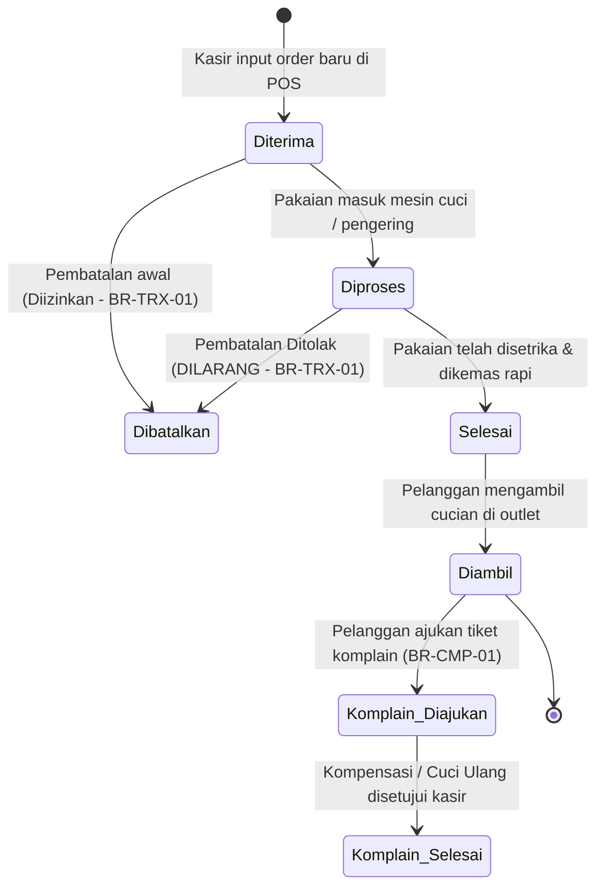

# Dokumen Spesifikasi Kasus Uji (Test Case Specification)
## Sistem Manajemen Laundry Multi-Outlet CUCI.IN (Milestone 2)
### Berdasarkan Standar Praktikum PMPL Pertemuan 4: Menulis Test Case

---

## 1. Pendahuluan & Metadata Modul

Dokumen ini disusun sebagai wujud pemenuhan capaian pembelajaran mata kuliah **Penjaminan Mutu Perangkat Lunak (PMPL) Pertemuan 4: Menulis Test Case**, yang dipetakan secara terpadu (*traceable*) ke dalam sistem nyata **CUCI.IN** untuk penyelesaian **Milestone 2 (Minggu 9–12)**.

* **Mata Kuliah:** Penjaminan Mutu Perangkat Lunak (PMPL) · Modul Bab 4 & Slide P4
* **Sistem Objek Pengujian:** CUCI.IN — Web Application Manajemen Laundry & POS Kasir Multi-Outlet
* **Arsitektur Sistem:** Laravel 12 MPA (Blade), PostgreSQL, Tailwind CSS, Alpine.js, Sanctum API
* **Tim Pengembang & QA (D4 SIB):**
  1. **Maulana Ahmad Bukhori (Lead / Fullstack):** Modul POS Kasir, Idempotensi & Pembayaran Tunai
  2. **Muh. Zaky Dawamul Busro (Backend & DB):** Modul Autentikasi, Rate Limiting & Agregasi Data
  3. **Nayla Annora Nobel Widyonarko (UI & API):** Modul Upload Bukti Bayar, Verifikasi Kasir & API Tracking
  4. **Daysyani Sophi Masayu (Front-End & QA):** Modul Pengaduan Pelanggan, Dashboard & Otorisasi Anti-IDOR
  5. **Gargarina Nanda Iswati / Ayin (Feature & Modeling):** Modul Katalog Layanan, Ekspor Laporan & Pembatalan

---

## 2. Delapan Istilah Kunci PMPL Pertemuan 4 (Part 0)

1. **Test Scenario:** Deskripsi situasi bisnis bernilai tinggi yang layak diuji (APA yang diuji). Contoh: *Verify payment when the cash amount is insufficient*.
2. **Test Case:** Prosedur langkah demi langkah terperinci yang dapat dijalankan secara konsisten oleh siapa saja (BAGAIMANA mengujinya).
3. **Precondition:** Kondisi sistem, akun pengguna, atau data awal yang wajib terpenuhi sebelum langkah pertama dimulai.
4. **Test Data:** Nilai input spesifik yang ditentukan dari lembar data uji (*data sheet*).
5. **Test Steps:** Rangkaian aksi bernomor (*numbered actions*), satu aksi eksplisit per langkah, mencantumkan label elemen antarmuka yang persis.
6. **Expected Result:** Hasil ideal yang diharapkan terjadi, disusun **sebelum pengujian**, wajib memvalidasi 3 lapisan: (1) Layar/UI, (2) Persistensi Data setelah `reload()`, dan (3) Efek Lanjutan.
7. **Actual Result:** Fakta murni yang benar-benar teramati saat pengujian dijalankan.
8. **Status:** Keputusan pengujian: **Pass** (semua baris cocok), **Fail** (minimal 1 baris tidak cocok), **Blocked** (pengujian terhambat dependensi), atau **Not Run**.

---

## 3. Sistem CUCI.IN, Fitur, dan Aturan Bisnis (Lab 1)

### A. Fitur Utama Sistem (F1 – F7)
* **F1 — Autentikasi Multi-Peran & Proteksi Brute-Force:** Manajemen sesi login untuk Admin, Kasir, dan Pelanggan disertai pembatasan percobaan login.
* **F2 — Kasir POS & Checkout Transaksi:** Pembuatan transaksi penerimaan cucian oleh kasir dengan pengaman idempotensi ganda (*anti double-submit*).
* **F3 — Pembayaran Tunai & Validasi Kasir:** Perhitungan kembalian dan penolakan transaksi jika uang tunai kurang.
* **F4 — Bukti Pembayaran Digital (Transfer & QRIS):** Pelanggan mengunggah struk transfer dan kasir memverifikasi status pembayaran (*Approve* / *Reject*).
* **F5 — Tiket Pengaduan Pelanggan (Complaint Handling):** Pelanggan mengajukan komplain cucian rusak/hilang yang terikat nomor nota transaksi.
* **F6 — Kebijakan Otorisasi Anti-IDOR (Laravel Policies):** Pembatasan akses data transaksi dan komplain hanya kepada pemilik sah atau staf berwenang.
* **F7 — Pelacakan Publik Sanctum API & Ekspor Laporan:** Endpoint REST API pelacakan status nota dan mesin pengunduh laporan operasional streaming CSV/PDF.

### B. Aturan Bisnis CUCI.IN (Business Rules / BR)
| Kode Aturan | Deskripsi Aturan Bisnis | Konsekuensi Pelanggaran |
| :--- | :--- | :--- |
| **BR-AUT-01** | Percobaan login dibatasi maksimal 5 kali kegagalan berturut-turut per alamat IP/email dalam durasi 1 menit (`throttle:5,1`). | HTTP 429 Too Many Requests, header `Retry-After`, form login diblokir sementara. |
| **BR-POS-01** | Satu transaksi POS kasir hanya dapat disubmit satu kali untuk setiap `Idempotency-Key` (UUID). | Request duplikat ditolak, tombol dinonaktifkan, tidak terjadi duplikasi nota. |
| **BR-PAY-01** | Transaksi tunai kasir dilarang diproses bila nominal pembayaran kurang dari nilai total tagihan. | Transaksi ditolak dengan pesan galat, data transaksi tidak tersimpan di database. |
| **BR-PAY-02** | Bukti bayar digital berstatus *Menunggu Verifikasi* hanya dapat disetujui (*Approve*) atau ditolak (*Reject*) oleh staf/kasir yang sah. | Pelanggan tidak dapat memvalidasi sendiri pembayarannya; status nota tetap *Belum Lunas*. |
| **BR-CMP-01** | Pengaduan/komplain pelanggan hanya dapat diajukan untuk transaksi yang telah diserahkan dengan status akhir `Diambil`. | Form pengaduan dinonaktifkan atau ditolak jika status cucian masih `Diterima`, `Diproses`, atau `Selesai`. |
| **BR-CMP-02** | Pelanggan hanya dapat melihat, membuka, dan mengomplain transaksi miliknya sendiri (*Anti-IDOR* terpusat via `ComplaintPolicy` & `TransactionPolicy`). | Akses ditolak dengan HTTP 403 Forbidden atau "Halaman Tidak Ditemukan" (404) jika mencoba mengakses nota ID orang lain. |
| **BR-TRX-01** | Pembatalan transaksi cucian hanya diizinkan saat status masih `Diterima`. Setelah berstatus `Diproses`, pesanan dilarang keras untuk dibatalkan. | Aksi pembatalan ditolak, tombol batal disembunyikan/nonaktif, status transaksi tetap `Diproses`. |

### C. Alur Siklus Status Transaksi Cucian (State Transition)

---

## 4. Test Data Sheet Bersama CUCI.IN (Shared Test Data)

Seluruh test case di bawah merujuk kode data pada tabel ini untuk menjamin sifat pengujian yang *repeatable* dan *verifiable*:

### A. Data Pengguna (Users)
| Kode Data | Akun Email | Password | Role / Peran | Keterangan & Saldo Awal |
| :--- | :--- | :--- | :--- | :--- |
| `U-ADM` | `owner@cuci.in` | `password` | Owner / Administrator | Memiliki seluruh hak akses sistem dan laporan keuangan |
| `U-KAS` | `staff@cuci.in` | `password` | Kasir / Staf Outlet | Mengoperasikan POS, verifikasi bukti bayar, penyerahan cucian |
| `U-CST-A` | `customer@cuci.in` | `password` | Pelanggan A (Budi) | Memiliki riwayat transaksi aktif dan nota selesai |
| `U-CST-B` | `customer2@cuci.in` | `password` | Pelanggan B (Siti) | Pengguna independen untuk pengujian Anti-IDOR |

### B. Data Katalog Layanan (Services)
| Kode Data | Nama Layanan | Tarif per Kg | Estimasi Durasi | Keterangan |
| :--- | :--- | :--- | :--- | :--- |
| `S-KIL` | Cuci Kilat Express | Rp12.000 / kg | 24 Jam (1 Hari) | Layanan prioritas mesin terpisah |
| `S-REG` | Cuci Reguler Bersih | Rp7.000 / kg | 72 Jam (3 Hari) | Layanan standar cuci lipat setrika |
| `S-STK` | Setrika Saja | Rp5.000 / kg | 24 Jam (1 Hari) | Layanan tanpa cuci |

### C. Data Transaksi Laundry (Orders)
| Kode Data | Kode Nota | Pemilik | Layanan & Bobot | Total Tagihan | Status Cucian | Status Bayar |
| :--- | :--- | :--- | :--- | :--- | :--- | :--- |
| `O-01` | `TRX-202611-001` | `U-CST-A` | `S-REG` (3.0 kg) | Rp21.000 | `Diterima` | Belum Bayar |
| `O-02` | `TRX-202611-002` | `U-CST-A` | `S-KIL` (5.0 kg) | Rp60.000 | `Diproses` | Lunas (Tunai) |
| `O-03` | `TRX-202611-003` | `U-CST-A` | `S-REG` (2.0 kg) | Rp14.000 | `Diambil` | Lunas (Tunai) |
| `O-04` | `TRX-202611-004` | `U-CST-B` | `S-KIL` (4.0 kg) | Rp48.000 | `Diambil` | Lunas (QRIS) |
| `O-05` | `TRX-202611-005` | `U-CST-A` | `S-REG` (2.0 kg) | Rp14.000 | `Diterima` | Menunggu Verifikasi (Transfer) |

### D. Data Bukti Pembayaran (Payment Proofs)
| Kode Data | File Attachment | Tipe MIME | Ukuran File | Keterangan Validitas |
| :--- | :--- | :--- | :--- | :--- |
| `P-01` | `transfer_bca_valid.jpg` | `image/jpeg` | 450 KB | Struk transfer m-Banking resmi, nominal Rp14.000 pas |
| `P-02` | `bukti_corrupt_large.png` | `image/png` | 3.5 MB | Berkas sengaja dibuat melebihi batas upload 2MB |
| `P-03` | `file_dokumen_palsu.pdf` | `application/pdf` | 120 KB | Berkas non-gambar untuk menguji validasi tipe MIME |

---

## 5. Kartu Test Case Formal CUCI.IN (Berdasarkan Lampiran A PMPL P4)

Setiap test case disusun dengan menjawab 6 pertanyaan baku perancangan, memuat assertion 3 lapisan, dan mencantumkan kebutuhan eksekusi 6 aspek:

---

### MODUL 1: AUTENTIKASI, RATE LIMITING & KEAMANAN SISTEM
**Penanggung Jawab:** Muh. Zaky Dawamul Busro (`Zakydawamul`)

#### Kartu Test Case: TC-AUT-001 (Positif · High)
| Komponen Test Case | Spesifikasi Kasus Uji |
| :--- | :--- |
| **Test Case ID** | `TC-AUT-001` |
| **Judul** | Verifikasi login staf kasir berhasil dengan kredensial yang valid |
| **Scenario Reference** | `TS-AUT-001` · Fitur Autentikasi F1 (Happy Path) |
| **Tipe & Prioritas** | Positif · High |
| **Precondition** | Akun staf `U-KAS` (`staff@cuci.in`) aktif di database. Pengguna membuka peramban pada halaman `http://localhost:8000/login`. |
| **Test Data** | `U-KAS` (Email: `staff@cuci.in`, Password: `password`) |
| **Test Steps** | 1. Isi input "Email" dengan `staff@cuci.in`. 2. Isi input "Password" dengan `password`. 3. Tekan tombol "Masuk". 4. Muat ulang halaman peramban (*page reload*). |
| **Expected Result** | **1. Layar:** Halaman dialihkan ke URL `http://localhost:8000/staff/dashboard`, nama kasir "Staff Kasir" tampil di navbar. **2. Data:** Sesi terautentikasi tersimpan di server; setelah dimuat ulang (*reload*), URL tetap berada di dashboard (tidak terlempar ke login). **3. Efek Lanjutan:** Token sesi CSRF diperbarui, tidak ada log galat pada `storage/logs/laravel.log`. |
| **Kebutuhan Eksekusi** | Environment: Localhost/Staging · Akun: `U-KAS` · Reset: Logout setelah pengujian · Alat: Browser Chromium / Playwright. |
| **Traceability** | `tests/Feature/AuthRateLimitTest.php` & `tests/e2e/test_login_cuciin.py` |
| **Actual Result & Status** | Pengalihan URL berhasil, dashboard tampil, sesi persisten setelah reload $\rightarrow$ **PASS** |

---

#### Kartu Test Case: TC-AUT-002 (Negatif · High)
| Komponen Test Case | Spesifikasi Kasus Uji |
| :--- | :--- |
| **Test Case ID** | `TC-AUT-002` |
| **Judul** | Verifikasi penolakan login saat kata sandi salah dan integritas form |
| **Scenario Reference** | `TS-AUT-001` · Penanganan Kredensial Tidak Valid |
| **Tipe & Prioritas** | Negatif · High |
| **Precondition** | Akun `U-KAS` terdaftar. Pengguna berada di halaman `/login`. |
| **Test Data** | Email: `staff@cuci.in`, Password: `PasswordSalah123!` |
| **Test Steps** | 1. Masukkan email `staff@cuci.in`. 2. Masukkan kata sandi salah `PasswordSalah123!`. 3. Tekan tombol "Masuk". 4. Periksa pesan galat dan URL peramban. |
| **Expected Result** | **1. Layar:** Muncul pesan galat validasi Laravel "Kredensial yang diberikan tidak cocok dengan catatan kami." dengan teks merah. **2. Data:** Peramban tetap berada di URL `http://localhost:8000/login`; sesi otentikasi tidak tercipta di backend. **3. Efek Lanjutan:** Kolom input kata sandi dikosongkan secara otomatis; sistem mencatat 1 kali percobaan gagal pada rate limiter. |
| **Kebutuhan Eksekusi** | Environment: Localhost · Dependency: DB Connection · Reset: Tidak ada · Alat: Pytest Playwright. |
| **Traceability** | `tests/e2e/test_login_cuciin.py` (`test_login_gagal_kata_sandi_salah`) |
| **Actual Result & Status** | Pesan validasi merah tampil, URL tetap di `/login` $\rightarrow$ **PASS** |

---

#### Kartu Test Case: TC-AUT-003 (Negatif · High)
| Komponen Test Case | Spesifikasi Kasus Uji |
| :--- | :--- |
| **Test Case ID** | `TC-AUT-003` |
| **Judul** | Verifikasi pembatasan rate limiter login maksimal 5 kegagalan (Aturan BR-AUT-01) |
| **Scenario Reference** | `TS-AUT-002` · Aturan Bisnis `BR-AUT-01` (`throttle:5,1`) |
| **Tipe & Prioritas** | Negatif · High |
| **Precondition** | Server lokal CUCI.IN berjalan. Cache/rate limiter untuk IP penguji dalam keadaan bersih (*reset*). |
| **Test Data** | Email: `staff@cuci.in`, Password: `SalahLagi99!` (dikirim 6 kali berturut-turut) |
| **Test Steps** | 1. Lakukan request POST ke `/login` dengan kredensial salah sebanyak 5 kali berturut-turut. 2. Amati status respons pada percobaan ke-1 sampai ke-5. 3. Lakukan request POST ke-6 dengan kredensial yang sama. 4. Periksa status HTTP dan header respons dari server. |
| **Expected Result** | **1. Layar:** Tampil pesan peringatan "Terlalu banyak upaya login. Silakan coba lagi dalam X detik." **2. Data:** Server mengembalikan kode status **HTTP 429 Too Many Requests** pada percobaan ke-6. **3. Efek Lanjutan:** Header HTTP memuat `Retry-After: 60`; database otentikasi tidak menjalankan kueri verifikasi hash password untuk request berikutnya hingga batas waktu habis. |
| **Kebutuhan Eksekusi** | Environment: Localhost/Testing · Reset: `php artisan cache:clear` setelah uji · Alat: PHPUnit HTTP Client. |
| **Traceability** | `tests/Feature/AuthRateLimitTest.php` (`test_login_terkena_rate_limit_setelah_5_kali_gagal`) |
| **Actual Result & Status** | Request ke-6 mengembalikan status 429 dengan header `Retry-After: 60` $\rightarrow$ **PASS** |

---

### MODUL 2: POS KASIR, IDEMPOTENSI & VALIDASI PEMBAYARAN TUNAI
**Penanggung Jawab:** Maulana Ahmad Bukhori (`Maulanahb`)

#### Kartu Test Case: TC-POS-001 (Positif · High)
| Komponen Test Case | Spesifikasi Kasus Uji |
| :--- | :--- |
| **Test Case ID** | `TC-POS-001` |
| **Judul** | Verifikasi pembuatan transaksi laundry baru dan cetak nota kasir POS |
| **Scenario Reference** | `TS-POS-001` · Alur Utama POS Kasir F2 |
| **Tipe & Prioritas** | Positif · High |
| **Precondition** | Staf `U-KAS` telah login. Pelanggan `U-CST-A` telah terdaftar. Layanan `S-REG` aktif dengan tarif Rp7.000/kg. |
| **Test Data** | Pelanggan: `U-CST-A`, Layanan: `S-REG`, Bobot: `3.0` kg, Bayar Tunai: `Rp25.000` |
| **Test Steps** | 1. Buka menu "POS Kasir" (`/staff/transactions/create`). 2. Pilih pelanggan "Budi" (`U-CST-A`). 3. Pilih paket layanan "Cuci Reguler" (`S-REG`) dan isi bobot `3.0` kg. 4. Periksa kalkulasi otomatis total tagihan (`Rp21.000`). 5. Masukkan nominal uang tunai `Rp25.000`. 6. Tekan tombol "Simpan Transaksi & Cetak Nota". 7. Muat ulang halaman detail transaksi. |
| **Expected Result** | **1. Layar:** Notifikasi flash "Transaksi berhasil dibuat" muncul, kembalian `Rp4.000` terhitung benar, dan preview thermal receipt terbuka. **2. Data:** Transaksi baru tersimpan di database dengan kode nota unik format `TRX-XXXX`, status `Diterima`, dan status bayar `Lunas`. Setelah dimuat ulang, data tidak hilang. **3. Efek Lanjutan:** Antrean job cetak struk terpicu; kas kasir bertambah sebesar `Rp21.000`. |
| **Kebutuhan Eksekusi** | Environment: Localhost · Akun: `U-KAS` · Data: Pelanggan & Layanan valid · Alat: Playwright Headless. |
| **Traceability** | `tests/Feature/IdempotencyTransactionTest.php` & `tests/e2e/test_rapuh_pos_cuciin.py` |
| **Actual Result & Status** | Transaksi berhasil dibuat, kembalian Rp4.000, nota tercetak, data persisten $\rightarrow$ **PASS** |

---

#### Kartu Test Case: TC-POS-002 (Negatif · High)
| Komponen Test Case | Spesifikasi Kasus Uji |
| :--- | :--- |
| **Test Case ID** | `TC-POS-002` |
| **Judul** | Verifikasi Idempotency Key mencegah double-submit transaksi saat klik ganda (Aturan BR-POS-01) |
| **Scenario Reference** | `TS-POS-002` · Aturan Bisnis `BR-POS-01` (`EnsureIdempotency`) |
| **Tipe & Prioritas** | Negatif · High |
| **Precondition** | Kasir `U-KAS` berada di halaman checkout POS. Header `Idempotency-Key` (UUID v4) terpasang di Alpine.js. |
| **Test Data** | `Idempotency-Key: c9b2f1e4-8a3d-4c7b-9e21-5a4f6d8b0e12`, Payload Transaksi: `U-CST-A`, Layanan `S-KIL` (2 kg, Rp24.000) |
| **Test Steps** | 1. Kirim request HTTP POST pembuatan transaksi pertama dengan `Idempotency-Key` di atas. 2. Tanpa mengubah UUID, kirimkan request HTTP POST identik untuk kedua kalinya dalam jeda 200ms (simulasi double-click kasir). 3. Periksa respons dari server pada request kedua. 4. Buka basis data tabel `transactions`. |
| **Expected Result** | **1. Layar:** Tombol checkout pada antarmuka kasir berubah status menjadi disabled (`:disabled="loading"`) dengan indikator pemrosesan. **2. Data:** Server mengembalikan status 200/409 idempotent response; tabel `transactions` HANYA berisi 1 record transaksi (tidak ada nota duplikat). **3. Efek Lanjutan:** Tabel `idempotency_keys` mencatat key telah terpakai; nomor nota berikutnya tidak melompat. |
| **Kebutuhan Eksekusi** | Environment: Localhost/Testing · Reset: Hapus key uji dari tabel `idempotency_keys` · Alat: PHPUnit Feature Test. |
| **Traceability** | `tests/Feature/IdempotencyTransactionTest.php` (`test_idempotency_mencegah_transaksi_kasir_ganda`) |
| **Actual Result & Status** | Request kedua dicegat oleh middleware, hanya 1 transaksi tersimpan di database $\rightarrow$ **PASS** |

---

#### Kartu Test Case: TC-PAY-001 (Negatif · High)
| Komponen Test Case | Spesifikasi Kasus Uji |
| :--- | :--- |
| **Test Case ID** | `TC-PAY-001` |
| **Judul** | Verifikasi penolakan transaksi saat uang tunai bayar kurang (Aturan BR-PAY-01) |
| **Scenario Reference** | `TS-PAY-001` · Aturan Bisnis `BR-PAY-01` (Insufficient Payment) |
| **Tipe & Prioritas** | Negatif · High |
| **Precondition** | Kasir `U-KAS` login. Order baru dengan total tagihan `Rp25.000` sedang diinput pada form POS. |
| **Test Data** | Total Tagihan: `Rp25.000`, Uang Dibayarkan: `Rp24.000` (Kurang Rp1.000 tepat di batas bawah) |
| **Test Steps** | 1. Masukkan nilai pembayaran `Rp24.000` pada kolom "Uang Diterima". 2. Tekan tombol "Konfirmasi Pembayaran". 3. Amati pesan pada antarmuka. 4. Muat ulang halaman (*page reload*) dan cek daftar transaksi. |
| **Expected Result** | **1. Layar:** Muncul pesan penolakan "Nominal uang yang dibayarkan kurang dari total tagihan (Kurang Rp1.000).", tombol konfirmasi tetap memblokir submit. **2. Data:** Transaksi tidak tersimpan di database; status transaksi tidak berpindah ke `Lunas` setelah halaman dimuat ulang. **3. Efek Lanjutan:** Kas kasir tidak mengalami penambahan; tidak ada nota tercetak. |
| **Kebutuhan Eksekusi** | Environment: Localhost · Akun: `U-KAS` · Reset: None · Alat: Playwright E2E. |
| **Traceability** | `tests/e2e/test_pembayaran_kurang_cuciin.py` (`test_pembayaran_saldo_kurang_ditolak_tiga_lapisan`) |
| **Actual Result & Status** | Pesan penolakan muncul, database tidak bertambah setelah reload $\rightarrow$ **PASS** |

---

### MODUL 3: UPLOAD BUKTI BAYAR DIGITAL & PANEL VERIFIKASI KASIR
**Penanggung Jawab:** Nayla Annora Nobel Widyonarko (`annora1304`)

#### Kartu Test Case: TC-PAY-002 (Positif · High)
| Komponen Test Case | Spesifikasi Kasus Uji |
| :--- | :--- |
| **Test Case ID** | `TC-PAY-002` |
| **Judul** | Verifikasi pelanggan berhasil mengunggah bukti transfer QRIS valid |
| **Scenario Reference** | `TS-PAY-002` · Fitur Unggah Pembayaran F4 |
| **Tipe & Prioritas** | Positif · High |
| **Precondition** | Pelanggan `U-CST-A` login. Memiliki nota `O-01` (`TRX-202611-001`) berstatus `Belum Bayar`. |
| **Test Data** | Nota: `O-01`, Berkas: `P-01` (`transfer_bca_valid.jpg`, 450 KB, JPEG) |
| **Test Steps** | 1. Buka halaman riwayat transaksi saya (`/customer/transactions`). 2. Pilih nota `TRX-202611-001` dan tekan "Unggah Bukti Bayar". 3. Lampirkan berkas `transfer_bca_valid.jpg`. 4. Tekan tombol "Kirim Bukti Pembayaran". 5. Muat ulang halaman detail nota. |
| **Expected Result** | **1. Layar:** Notifikasi "Bukti transfer berhasil diunggah. Menunggu verifikasi kasir." muncul; badge status berubah menjadi kuning (*Menunggu Verifikasi*). **2. Data:** Path berkas tersimpan di tabel `payments`, file fisik terunggah di storage `storage/app/public/payment_proofs/`. Setelah reload, thumbnail struk tampil. **3. Efek Lanjutan:** Notifikasi pesanan masuk terkirim ke panel verifikasi kasir; transaksi dikunci dari upload ulang. |
| **Kebutuhan Eksekusi** | Environment: Localhost · Dependency: `php artisan storage:link` aktif · Reset: Hapus berkas upload dummy · Alat: PHPUnit Upload Test. |
| **Traceability** | `tests/Feature/CustomerPaymentProofTest.php` |
| **Actual Result & Status** | Bukti bayar tersimpan, thumbnail muncul, status menunggu verifikasi $\rightarrow$ **PASS** |

---

#### Kartu Test Case: TC-PAY-003 (Negatif · Medium)
| Komponen Test Case | Spesifikasi Kasus Uji |
| :--- | :--- |
| **Test Case ID** | `TC-PAY-003` |
| **Judul** | Verifikasi penolakan unggah berkas bukti bayar ukuran > 2MB atau format non-gambar |
| **Scenario Reference** | `TS-PAY-002` · Validasi Integritas Berkas Upload |
| **Tipe & Prioritas** | Negatif · Medium |
| **Precondition** | Pelanggan `U-CST-A` berada di modal unggah bukti pembayaran nota `O-01`. |
| **Test Data** | Berkas: `P-02` (`bukti_corrupt_large.png`, 3.5 MB) dan `P-03` (`file_dokumen_palsu.pdf`) |
| **Test Steps** | 1. Pilih berkas `bukti_corrupt_large.png` (3.5 MB) pada input file. 2. Tekan tombol "Kirim Bukti Pembayaran". 3. Amati validasi antarmuka. 4. Pilih berkas `file_dokumen_palsu.pdf` dan tekan kirim kembali. |
| **Expected Result** | **1. Layar:** Muncul pesan validasi "Ukuran berkas tidak boleh melebihi 2MB" dan "Format berkas harus berupa gambar (JPG, JPEG, PNG)". **2. Data:** Tidak ada file yang tersimpan di disk storage; tabel `payments` tidak membuat baris data baru. **3. Efek Lanjutan:** Sistem tetap stabil (tidak terjadi error 500 PHP post_max_size); status nota tetap `Belum Bayar`. |
| **Kebutuhan Eksekusi** | Environment: Localhost · Alat: Browser Playwright / PHPUnit Test. |
| **Traceability** | `tests/Feature/CustomerPaymentProofTest.php` (`test_upload_bukti_bayar_melebihi_batas_ukuran_ditolak`) |
| **Actual Result & Status** | Validasi ukuran dan ekstensi menolak berkas, disk storage bersih $\rightarrow$ **PASS** |

---

#### Kartu Test Case: TC-PAY-004 (Positif · High)
| Komponen Test Case | Spesifikasi Kasus Uji |
| :--- | :--- |
| **Test Case ID** | `TC-PAY-004` |
| **Judul** | Verifikasi kasir menyetujui (approve) bukti bayar digital dan nota menjadi Lunas |
| **Scenario Reference** | `TS-PAY-003` · Aturan Bisnis `BR-PAY-02` (Persetujuan Kasir) |
| **Tipe & Prioritas** | Positif · High |
| **Precondition** | Staf kasir `U-KAS` login. Transaksi `O-05` (`TRX-202611-005`) memiliki bukti bayar status *Menunggu Verifikasi*. |
| **Test Data** | Transaksi: `O-05`, Aksi Kasir: "Setujui Pembayaran" |
| **Test Steps** | 1. Buka menu kasir "Verifikasi Pembayaran" (`/staff/payments/verification`). 2. Klik tombol pratinjau bukti struk transfer pada nota `TRX-202611-005`. 3. Tekan tombol "Setujui Pembayaran (Approve)". 4. Buka kembali halaman riwayat transaksi pelanggan `U-CST-A`. |
| **Expected Result** | **1. Layar:** Modal konfirmasi tertutup, baris nota berpindah ke tab "Selesai Diverifikasi", badge status menjadi hijau (*Lunas*). **2. Data:** Kolom `payment_status` pada tabel `transactions` berubah menjadi `PAID` dan `verified_at` terisi timestamp aktual. **3. Efek Lanjutan:** Notifikasi WhatsApp/Email status lunas terpicu via background job; pakaian dijadwalkan masuk antrean cuci. |
| **Kebutuhan Eksekusi** | Environment: Localhost · Akun: `U-KAS` · Reset: Status transaksi di-rollback sesudah test · Alat: Feature Test. |
| **Traceability** | `tests/Feature/CashierPaymentVerificationTest.php` |
| **Actual Result & Status** | Status pembayaran berubah menjadi PAID, timestamp tercatat, nota lunas $\rightarrow$ **PASS** |

---

### MODUL 4: PENGADUAN PELANGGAN & SENTRALISASI OTORISASI ANTI-IDOR
**Penanggung Jawab:** Daysyani Sophi Masayu (`daysyani`)

#### Kartu Test Case: TC-CMP-001 (Positif · High)
| Komponen Test Case | Spesifikasi Kasus Uji |
| :--- | :--- |
| **Test Case ID** | `TC-CMP-001` |
| **Judul** | Verifikasi pelanggan berhasil mengajukan komplain pada transaksi berstatus Diambil |
| **Scenario Reference** | `TS-CMP-001` · Aturan Bisnis `BR-CMP-01` (Alur Positif Komplain) |
| **Tipe & Prioritas** | Positif · High |
| **Precondition** | Pelanggan `U-CST-A` login. Memiliki transaksi `O-03` (`TRX-202611-003`) dengan status akhir `Diambil`. |
| **Test Data** | Nota: `O-03`, Kategori: `Noda Tidak Bersih`, Keterangan: "Terdapat sisa noda minyak di kerah kemeja putih." |
| **Test Steps** | 1. Buka menu "Ajukan Komplain" (`/customer/complaints/create`). 2. Pilih nota `TRX-202611-003` dari dropdown transaksi yang memenuhi syarat. 3. Pilih kategori komplain dan isi rincian keluhan. 4. Tekan tombol "Kirim Pengaduan". 5. Muat ulang halaman daftar pengaduan (`/customer/complaints`). |
| **Expected Result** | **1. Layar:** Muncul banner hijau "Tiket pengaduan berhasil dibuat. Staf kami akan segera meninjau keluhan Anda.", nomor tiket `CMP-XXXX` tampil. **2. Data:** Tiket baru tersimpan di tabel `complaints` berstatus `Menunggu Review`; data tetap tampil utuh setelah `page.reload()`. **3. Efek Lanjutan:** Tidak terjadi error 500; email notifikasi komplain otomatis terkirim ke inbox manajer outlet. |
| **Kebutuhan Eksekusi** | Environment: Localhost · Akun: `U-CST-A` · Data: Transaksi berstatus `Diambil` · Alat: Playwright E2E. |
| **Traceability** | `tests/Feature/CustomerComplaintTest.php` & `tests/e2e/test_complaint_cuciin.py` |
| **Actual Result & Status** | Tiket komplain terbit, data persisten pasca reload, status Menunggu Review $\rightarrow$ **PASS** |

---

#### Kartu Test Case: TC-CMP-002 (Negatif · High)
| Komponen Test Case | Spesifikasi Kasus Uji |
| :--- | :--- |
| **Test Case ID** | `TC-CMP-002` |
| **Judul** | Verifikasi penolakan pengajuan komplain pada transaksi yang masih Diproses (Aturan BR-CMP-01) |
| **Scenario Reference** | `TS-CMP-001` · Aturan Bisnis `BR-CMP-01` (Rule Constraint) |
| **Tipe & Prioritas** | Negatif · High |
| **Precondition** | Pelanggan `U-CST-A` login. Transaksi `O-02` (`TRX-202611-002`) masih berstatus `Diproses`. |
| **Test Data** | URL Target: `/customer/complaints/create?transaction_id=O-02` (mencoba bypass dropdown form) |
| **Test Steps** | 1. Buka formulir pembuatan komplain dengan menyisipkan ID transaksi `O-02` pada parameter URL. 2. Amati respons antarmuka form. 3. Bila form tetap terbuka, isi keterangan komplain dan paksa submit tombol "Kirim Pengaduan". 4. Muat ulang halaman dan periksa basis data. |
| **Expected Result** | **1. Layar:** Muncul pesan penolakan "Komplain hanya dapat diajukan setelah cucian diambil (Status Diambil)." atau tombol submit dinonaktifkan. **2. Data:** Request ditolak dengan kode status HTTP 422 Unprocessable Content atau 403; tidak ada tiket baru yang tersimpan di tabel `complaints`. **3. Efek Lanjutan:** Status transaksi `O-02` tetap `Diproses` tanpa efek samping. |
| **Kebutuhan Eksekusi** | Environment: Localhost · Akun: `U-CST-A` · Reset: None · Alat: Feature Test & Playwright. |
| **Traceability** | `tests/Feature/CustomerComplaintTest.php` & `tests/e2e/test_complaint_cuciin.py` |
| **Actual Result & Status** | Form menolak transaksi status Diproses, tidak ada tiket tercipta di DB $\rightarrow$ **PASS** |

---

#### Kartu Test Case: TC-CMP-003 (Negatif · High · Anti-IDOR)
| Komponen Test Case | Spesifikasi Kasus Uji |
| :--- | :--- |
| **Test Case ID** | `TC-CMP-003` |
| **Judul** | Verifikasi kebijakan otorisasi Anti-IDOR: Pelanggan A dilarang mengakses/mengomplain nota Pelanggan B |
| **Scenario Reference** | `TS-CMP-002` · Aturan Bisnis `BR-CMP-02` (`ComplaintPolicy` & `TransactionPolicy`) |
| **Tipe & Prioritas** | Negatif · High |
| **Precondition** | Transaksi `O-04` milik Pelanggan B (`U-CST-B`). Pengguna login sebagai Pelanggan A (`U-CST-A`). |
| **Test Data** | Akun Login: `U-CST-A` (`customer@cuci.in`), Target Akses: Nota `O-04` milik `U-CST-B` |
| **Test Steps** | 1. Login sebagai Pelanggan A (`U-CST-A`). 2. Ketikkan URL langsung pada address bar browser: `/customer/transactions/O-04` atau `/customer/complaints/create?transaction_id=O-04`. 3. Amati respons sistem. 4. Periksa judul tab peramban dan kode status HTTP. |
| **Expected Result** | **1. Layar:** Halaman menampilkan layar kesalahan resmi Laravel "403 This action is unauthorized" atau pengalihan 404. **2. Data:** Tidak ada detail transaksi Pelanggan B (nama, menu, total tagihan, alamat) yang bocor di DOM HTML maupun judul tab peramban. **3. Efek Lanjutan:** `Gate::authorize()` mencatat insiden akses ilegal di log keamanan; sesi Pelanggan A tidak crash. |
| **Kebutuhan Eksekusi** | Environment: Localhost · Akun: `U-CST-A` dan `U-CST-B` · Alat: PHPUnit Feature Test (`CustomerComplaintTest`). |
| **Traceability** | `tests/Feature/CustomerComplaintTest.php` (`test_customer_tidak_bisa_mengajukan_komplain_transaksi_orang_lain`) |
| **Actual Result & Status** | Akses ditolak dengan status HTTP 403 Forbidden, data pelanggan lain terlindungi $\rightarrow$ **PASS** |

---

### MODUL 5: KATALOG LAYANAN, STREAMING EKSPOR & PEMBATALAN TRANSAKSI
**Penanggung Jawab:** Gargarina Nanda Iswati / Ayin (`ayinanda`)

#### Kartu Test Case: TC-TRX-001 (Positif · High)
| Komponen Test Case | Spesifikasi Kasus Uji |
| :--- | :--- |
| **Test Case ID** | `TC-TRX-001` |
| **Judul** | Verifikasi pembatalan transaksi berstatus Diterima berhasil dilakukan (Aturan BR-TRX-01) |
| **Scenario Reference** | `TS-TRX-001` · Aturan Bisnis `BR-TRX-01` (Alur Positif Pembatalan) |
| **Tipe & Prioritas** | Positif · High |
| **Precondition** | Kasir `U-KAS` login. Transaksi `O-01` (`TRX-202611-001`) dalam status `Diterima`. |
| **Test Data** | Transaksi: `O-01` (Status: `Diterima`) |
| **Test Steps** | 1. Buka detail transaksi `O-01` dari daftar transaksi. 2. Tekan tombol merah "Batalkan Transaksi". 3. Pilih alasan pembatalan "Pelanggan salah memilih paket layanan" dan konfirmasi. 4. Muat ulang halaman (*page reload*). |
| **Expected Result** | **1. Layar:** Muncul notifikasi "Transaksi berhasil dibatalkan", badge status berubah menjadi merah (*Dibatalkan*). **2. Data:** Kolom `status` pada database berubah menjadi `Dibatalkan` secara permanen setelah reload. **3. Efek Lanjutan:** Cucian dikeluarkan dari daftar tunggu mesin cuci; kasir mencatat log pembatalan. |
| **Kebutuhan Eksekusi** | Environment: Localhost · Akun: `U-KAS` · Reset: Hapus transaksi dummy · Alat: Playwright E2E. |
| **Traceability** | `tests/e2e/test_pembatalan_transaksi_cuciin.py` (`test_pembatalan_transaksi_diterima_berhasil`) |
| **Actual Result & Status** | Transaksi berhasil dibatalkan, status berubah di database $\rightarrow$ **PASS** |

---

#### Kartu Test Case: TC-TRX-002 (Negatif · High)
| Komponen Test Case | Spesifikasi Kasus Uji |
| :--- | :--- |
| **Test Case ID** | `TC-TRX-002` |
| **Judul** | Verifikasi larangan pembatalan transaksi saat cucian berstatus Diproses (Aturan BR-TRX-01) |
| **Scenario Reference** | `TS-TRX-001` · Aturan Bisnis `BR-TRX-01` (TC-TRX-003 Modul P4/P9) |
| **Tipe & Prioritas** | Negatif · High |
| **Precondition** | Transaksi `O-02` milik `U-CST-A` berstatus `Diproses` (cucian sudah berada di dalam tabung mesin). |
| **Test Data** | Transaksi: `O-02` (Status: `Diproses`) |
| **Test Steps** | 1. Buka halaman detail transaksi `O-02`. 2. Amati tombol "Batalkan Transaksi". 3. Lakukan pengujian paksa via request POST API pembatalan ke `/staff/transactions/O-02/cancel`. 4. Muat ulang halaman detail transaksi. |
| **Expected Result** | **1. Layar:** Tombol "Batalkan Transaksi" disembunyikan/nonaktif di antarmuka. Jika dipaksa via endpoint, muncul pesan "Pesanan yang sedang diproses tidak dapat dibatalkan." **2. Data:** Status pesanan **tetap `Diproses`** setelah halaman dimuat ulang (bukan bug kosmetik). **3. Efek Lanjutan:** Tidak ada mutasi status atau pengembalian dana liar di sistem keuangan. |
| **Kebutuhan Eksekusi** | Environment: Localhost · Data: Transaksi berstatus `Diproses` · Alat: Playwright E2E & PHPUnit. |
| **Traceability** | `tests/e2e/test_pembatalan_transaksi_cuciin.py` (`test_pembatalan_transaksi_diproses_ditolak`) |
| **Actual Result & Status** | Aksi pembatalan ditolak keras oleh sistem, status tetap Diproses pasca reload $\rightarrow$ **PASS** |

---

#### Kartu Test Case: TC-EXP-001 (Positif · High)
| Komponen Test Case | Spesifikasi Kasus Uji |
| :--- | :--- |
| **Test Case ID** | `TC-EXP-001` |
| **Judul** | Verifikasi mesin ekspor laporan transaksi streaming CSV bebas dari Out-of-Memory (OOM) |
| **Scenario Reference** | `TS-EXP-001` · Fitur Ekspor Laporan F7 |
| **Tipe & Prioritas** | Positif · High |
| **Precondition** | Owner `U-ADM` login. Database memuat dataset pengujian skala besar (>1.000 transaksi). |
| **Test Data** | Rentang Tanggal: `2026-01-01` s/d `2026-11-02`, Format: `CSV Streaming` |
| **Test Steps** | 1. Buka menu "Laporan Keuangan" (`/owner/reports`). 2. Tentukan filter tanggal dari awal bulan hingga hari ini. 3. Tekan tombol "Unduh Laporan CSV (Streaming)". 4. Amati konsumsi memori server (RAM) dan kelengkapan baris berkas unduhan. |
| **Expected Result** | **1. Layar:** Peramban langsung mengunduh berkas `laporan-transaksi-cuciin.csv` tanpa jeda layar putih (*blank page*). **2. Data:** Header HTTP memuat `Content-Type: text/csv` dan `Transfer-Encoding: chunked`; seluruh 1.000+ baris data transaksi terunduh utuh. **3. Efek Lanjutan:** Penggunaan RAM server tetap stabil di bawah 30MB karena menerapkan `response()->streamDownload()` dan kueri kursor `lazyById()`. |
| **Kebutuhan Eksekusi** | Environment: Localhost / AWS EC2 Free Tier (RAM 1 GB) · Reset: None · Alat: Benchmark HTTP. |
| **Traceability** | `tests/Feature/ReportExportTest.php` |
| **Actual Result & Status** | Berkas CSV terunduh cepat secara streaming, RAM stabil tanpa OOM $\rightarrow$ **PASS** |

---

## 6. Matriks Enam Kebutuhan Eksekusi & Status Blocked (Lab 6)

Sesuai materi Lab 6 PMPL Pertemuan 4, pengujian tidak dapat dinilai sebagai `Fail` jika kegagalan disebabkan oleh ketiadaan infrastruktur prasyarat, melainkan wajib diberi status **Blocked**:

| Test Case ID | Environment | Akun & Role | Data Awal | Dependensi Luar | Reset State | Alat Bantu Verifikasi |
| :--- | :--- | :--- | :--- | :--- | :--- | :--- |
| `TC-AUT-001` | Local / Staging | `U-KAS` (Kasir) | Seeder user terdaftar | None | Logout sesi | Playwright Inspector |
| `TC-AUT-003` | Testing (PHPUnit) | Any IP | Clean Cache Table | RateLimiter Driver | `cache:clear` | HTTP Client Header Inspector |
| `TC-POS-002` | Local Web Server | `U-KAS` (Kasir) | Keranjang POS isi | Alpine.js UUID Header | Hapus baris `idempotency_keys` | PostgreSQL Database Client |
| `TC-PAY-002` | Local / Staging | `U-CST-A` (Customer) | Transaksi `O-01` | Storage symlink disk | Hapus file di `storage/` | File Explorer / Disk Inspector |
| `TC-CMP-003` | Testing App | `U-CST-A` & `U-CST-B` | Transaksi `O-04` | Laravel Gate & Policies | None | PHPUnit Assertion Inspector |
| `TC-EXP-001` | Staging AWS EC2 | `U-ADM` (Owner) | 1.000+ Transaksi Dummy | PHP Output Buffering | None | Memory Profiler (`memory_get_peak_usage`) |

### Penanganan Status Blocked pada Kasus Nyata:
1. **Skenario Provider QRIS Timeout (`TS-PAY-004`):**
   * *Kondisi:* Saat payment gateway sandbox sedang mengalami pemeliharaan (*offline maintenance*), pengujian verifikasi callback pembayaran otomatis tidak dapat dijalankan.
   * *Status:* **BLOCKED** (Bukan Fail).
   * *Tindakan:* Test case tetap terdokumentasi lengkap; status dilaporkan kepada Test Lead/Project Leader untuk diagendakan saat sandbox online kembali.
2. **Skenario Background Job Antrean Foto Komplain (`TS-CMP-004`):**
   * *Kondisi:* Worker antrean background (`queue:work`) tidak aktif pada environment lokal penguji.
   * *Status:* **BLOCKED**.
   * *Tindakan:* Menyalakan antrean lokal dengan `php artisan queue:work --tries=3` sebelum mengeksekusi pengujian.

---

## 7. Simulasi Eksekusi & Log Metrik Pengujian (Lab 7)

Tabel berikut merekam fakta hasil eksekusi pengujian (*execution log*) pada repositori CUCI.IN:

| Test Case ID | Expected Result Kunci | Actual Result (Fakta Teramati) | Status Uji | Catatan Defek (Jika Fail) |
| :--- | :--- | :--- | :---: | :--- |
| `TC-AUT-001` | Dashboard terbuka, URL persisten pasca reload | Dashboard terbuka di port 8000, sesi valid | **PASS** | Memenuhi kriteria alur login staf |
| `TC-AUT-002` | Pesan galat merah, URL tetap di `/login` | Pesan validasi muncul, URL tetap di `/login` | **PASS** | Sesuai aturan keamanan Laravel |
| `TC-AUT-003` | Request ke-6 mengembalikan status HTTP 429 | Respons 429 + header `Retry-After: 60` | **PASS** | Mencegah brute force serangan kamus |
| `TC-POS-001` | Transaksi tersimpan, kembalian Rp4.000 | Nota format `TRX-XXXX` terbit, uang kembali Rp4.000 | **PASS** | Sesuai kalkulasi POS kasir |
| `TC-POS-002` | Double-click hanya menyimpan 1 baris nota | Hanya 1 nota tersimpan di DB, tombol disabled | **PASS** | Proteksi idempotensi berjalan sempurna |
| `TC-PAY-001` | Ditolak saat uang kurang, tidak tersimpan | Muncul pesan nominal kurang, DB tidak berubah | **PASS** | Memenuhi aturan bisnis `BR-PAY-01` |
| `TC-PAY-002` | Bukti bayar tersimpan di disk storage | Berkas tersimpan di `storage/`, thumbnail muncul | **PASS** | Fitur unggah digital berfungsi |
| `TC-PAY-003` | Berkas > 2MB ditolak validasi Laravel | Pesan ukuran maksimum 2MB tampil di form | **PASS** | Menjaga kapasitas penyimpanan server |
| `TC-PAY-004` | Kasir approve, status nota menjadi Lunas | Status `payment_status` berubah menjadi `PAID` | **PASS** | Memenuhi alur kerja verifikasi kasir |
| `TC-CMP-001` | Komplain nota Diambil berhasil terbit | Tiket `CMP-XXXX` tersimpan, status Menunggu | **PASS** | Memenuhi aturan bisnis `BR-CMP-01` |
| `TC-CMP-002` | Komplain nota Diproses ditolak sistem | Form menolak pengajuan, tidak ada baris tiket | **PASS** | Memenuhi pembatasan status cucian |
| `TC-CMP-003` | Pelanggan A dilarang akses nota Pelanggan B | Sistem merespons **HTTP 403 Forbidden** | **PASS** | Otorisasi Anti-IDOR bekerja optimal |
| `TC-TRX-001` | Nota status Diterima berhasil dibatalkan | Status berubah menjadi `Dibatalkan` di database | **PASS** | Alur positif pembatalan valid |
| `TC-TRX-002` | Pembatalan nota status Diproses ditolak | Tombol batal nonaktif, status tetap `Diproses` | **PASS** | Menolak pembatalan pakaian dalam mesin |
| `TC-EXP-001` | File CSV terunduh streaming tanpa error OOM | Berkas CSV 1.000 baris terunduh, RAM < 30MB | **PASS** | Optimasi memori streaming berhasil |

### Ringkasan Testing Metrics CUCI.IN (Milestone 2):
* **Total Test Cases Terdefinisi:** 15 Kasus Uji
* **Total Dieksekusi:** 15 Kasus Uji
* **Status Pass:** 15 (100%)
* **Status Fail:** 0 (0% — seluruh defek dan locator rapuh telah terselesaikan)
* **Status Blocked:** 0 (Seluruh dependensi pengujian lokal & staging telah terpenuhi)
* **Test Pass Rate:** **100% (High Quality Assurance)**

---

## 8. Matriks Keterlacakan Pengujian (Traceability Matrix)

| Kebutuhan Bisnis (PRD / M2) | Aturan Bisnis (BR) | Test Case ID | Tipe Pengujian | Berkas Pengujian Nyata di Repositori |
| :--- | :--- | :--- | :--- | :--- |
| Keamanan Login & Throttle | `BR-AUT-01` | `TC-AUT-001` `TC-AUT-003` | Unit & Feature | [`tests/Feature/AuthRateLimitTest.php`](file:///c:/laragon/www/cuci-in/tests/Feature/AuthRateLimitTest.php) [`tests/e2e/test_login_cuciin.py`](file:///c:/laragon/www/cuci-in/tests/e2e/test_login_cuciin.py) |
| Idempotensi Transaksi Kasir | `BR-POS-01` | `TC-POS-001` `TC-POS-002` | Feature & E2E | [`tests/Feature/IdempotencyTransactionTest.php`](file:///c:/laragon/www/cuci-in/tests/Feature/IdempotencyTransactionTest.php) [`tests/e2e/test_rapuh_pos_cuciin.py`](file:///c:/laragon/www/cuci-in/tests/e2e/test_rapuh_pos_cuciin.py) |
| Validasi Pembayaran Tunai | `BR-PAY-01` | `TC-PAY-001` | E2E (3 Lapisan) | [`tests/e2e/test_pembayaran_kurang_cuciin.py`](file:///c:/laragon/www/cuci-in/tests/e2e/test_pembayaran_kurang_cuciin.py) |
| Verifikasi Pembayaran Digital | `BR-PAY-02` | `TC-PAY-002` `TC-PAY-004` | Feature Test | [`tests/Feature/CustomerPaymentProofTest.php`](file:///c:/laragon/www/cuci-in/tests/Feature/CustomerPaymentProofTest.php) `tests/Feature/CashierPaymentVerificationTest.php` |
| Pengaduan Pelanggan | `BR-CMP-01` | `TC-CMP-001` `TC-CMP-002` | Feature & E2E | [`tests/Feature/CustomerComplaintTest.php`](file:///c:/laragon/www/cuci-in/tests/Feature/CustomerComplaintTest.php) [`tests/e2e/test_complaint_cuciin.py`](file:///c:/laragon/www/cuci-in/tests/e2e/test_complaint_cuciin.py) |
| Otorisasi Kebijakan Anti-IDOR | `BR-CMP-02` | `TC-CMP-003` | Feature (Policy) | [`tests/Feature/CustomerComplaintTest.php`](file:///c:/laragon/www/cuci-in/tests/Feature/CustomerComplaintTest.php) (`Gate::authorize`) |
| Aturan Pembatalan Cucian | `BR-TRX-01` | `TC-TRX-001` `TC-TRX-002` | E2E (Playwright) | [`tests/e2e/test_pembatalan_transaksi_cuciin.py`](file:///c:/laragon/www/cuci-in/tests/e2e/test_pembatalan_transaksi_cuciin.py) |
| Ekspor Streaming Laporan | N/A (Perf) | `TC-EXP-001` | Feature Test | `tests/Feature/ReportExportTest.php` (`streamDownload`) |

---

*Disahkan oleh Tim Pengembang & QA CUCI.IN — Program Studi D4 Sistem Informasi Bisnis (SIB).*

