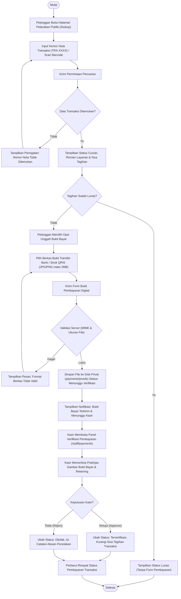
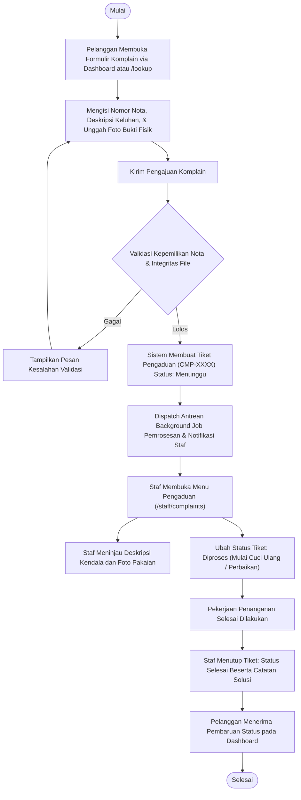
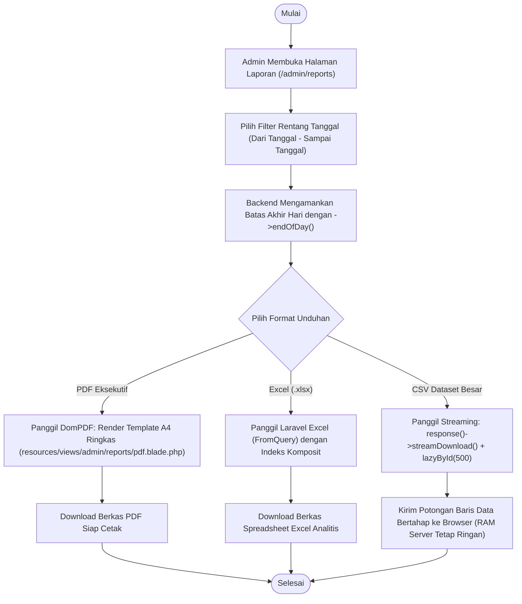
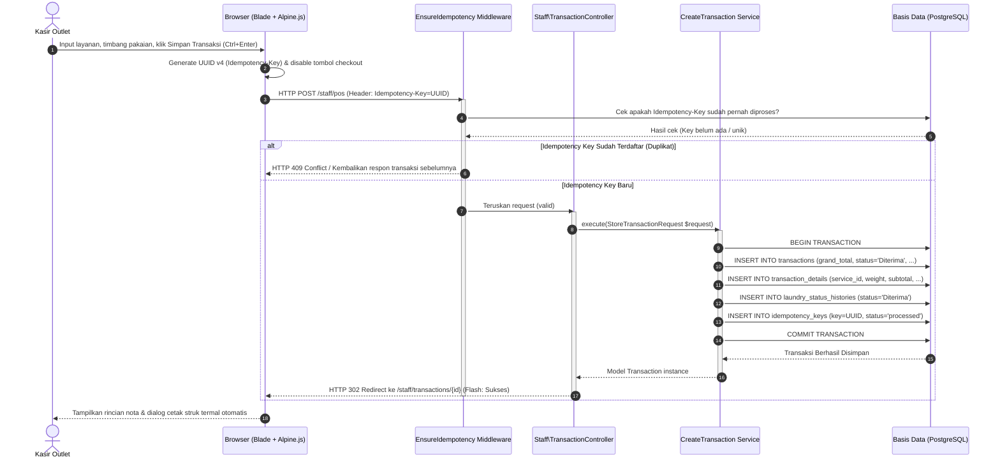
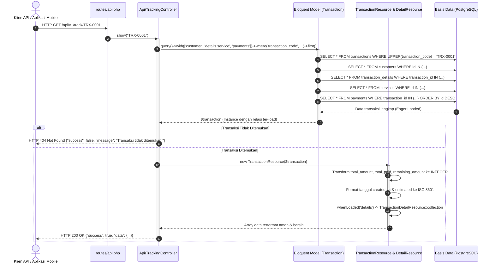
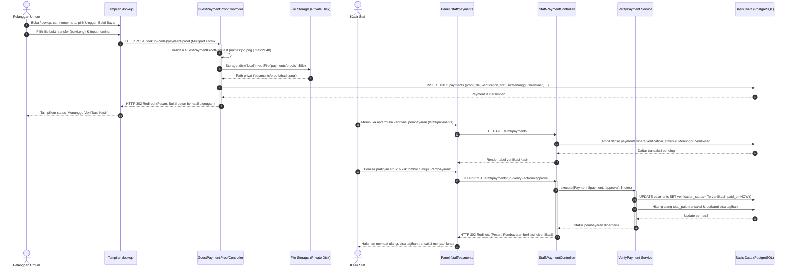
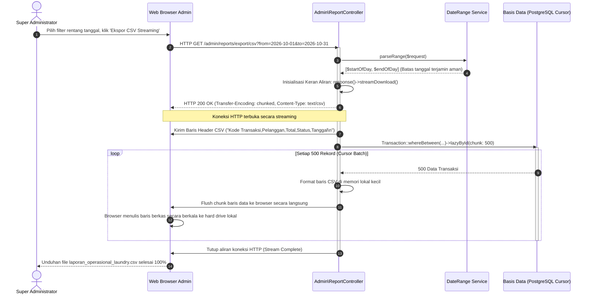

# Pemodelan Diagram Rekayasa Sistem CUCI.IN (Milestone 2)

**Sistem Informasi Manajemen Operasional Laundry Berbasis Web (Full Laravel MPA)**  
*D4 Sistem Informasi Bisnis — Politeknik Negeri Malang*  
*Penyusun: Gargarina Nanda Iswati / Ayin (`ayinanda`)*

---

Dokumen ini memuat rekonstruksi diagram alur rekayasa perangkat lunak (*Activity Diagram* dan *Sequence Diagram*) yang selaras dengan arsitektur kode program aktual (*reverse engineering*) sistem **CUCI.IN** untuk pemenuhan deliverable Milestone 2 (Minggu 9–12) dan materi Pertemuan 9–10 Pemrograman Web Lanjut (PWL).

---

## 1. Activity Diagrams (AD)

### AD-01: Alur Pembuatan Transaksi Kasir POS (Multi-Layanan & SOP Kilat)
Diagram ini menggambarkan alur kerja kasir dalam membuat pesanan laundry multi-layanan, integrasi indikator paket kilat (*express*), dan penyimpanan nota dengan proteksi idempotency.

```mermaid
flowchart TD
    Start(["Mulai"]) --> OpenPOS["Kasir Membuka Halaman POS (/staff/pos)"]
    OpenPOS --> SelectCustomer{"Pelanggan Sudah Terdaftar?"}
    
    SelectCustomer -- "Ya" --> PickCustomer["Pilih Pelanggan dari Daftar Dropdown"]
    SelectCustomer -- "Tidak" --> QuickCreateCustomer["Klik Alt+P: Tambah Data Pelanggan Baru via Modal"]
    QuickCreateCustomer --> PickCustomer
    
    PickCustomer --> AddServiceRow["Tambah Baris Layanan (Klik Alt+T)"]
    AddServiceRow --> SelectService["Pilih Layanan (Reguler / Kiloan / Satuan / Kilat)"]
    SelectService --> InputWeight["Input Berat Cucian (kg) atau Jumlah Satuan (pcs)"]
    
    InputWeight --> CheckExpress{"Layanan Mengandung Paket Kilat (Express)?"}
    CheckExpress -- "Ya" --> ShowExpressAlert["Tampilkan Banner SOP Express: Pasang Pita/Label Fisik Kilat"]
    CheckExpress -- "Tidak" --> CalcSubtotal["Hitung Subtotal Item"]
    ShowExpressAlert --> CalcSubtotal
    
    CalcSubtotal --> MoreItems{"Ada Layanan Tambahan Lain?"}
    MoreItems -- "Ya" --> AddServiceRow
    MoreItems -- "Tidak" --> CalcTotal["Hitung Grand Total & Estimasi Selesai (Alpine.js)"]
    
    CalcTotal --> SubmitPOS["Kasir Menekan Simpan Transaksi (Ctrl+Enter)"]
    SubmitPOS --> GenIdempotency["Alpine.js Membuat UUID Idempotency-Key & Disable Tombol"]
    GenIdempotency --> SendRequest["Kirim HTTP POST ke /staff/pos"]
    
    SendRequest --> ValidateBackend{"Validasi Backend & Idempotency Check"}
    ValidateBackend -- "Gagal / Duplikat" --> ReturnError["Tampilkan Pesan Kesalahan / Cegah Transaksi Ganda"]
    ReturnError --> CalcTotal
    
    ValidateBackend -- "Lolos" --> SaveDB["Database Menyimpan Header Transaksi, Detail Items, & Status Diterima"]
    SaveDB --> ShowReceipt["Tampilkan Nota Transaksi & Opsi Cetak Struk Termal (58mm/80mm)"]
    ShowReceipt --> End(["Selesai"])
```

---

### AD-02: Alur Pelacakan Cucian Publik & Pembayaran Digital
Diagram ini memetakan alur pelanggan umum/tamu melacak status pesanan secara mandiri tanpa login, mengunggah bukti bayar transfer/QRIS, hingga kasir melakukan verifikasi persetujuan.

---

### AD-03: Alur Penanganan Tiket Pengaduan Pelanggan (Complaint Handling)
Diagram ini menggambarkan penanganan keluhan pelanggan (noda pakaian tertinggal, kerusakan, atau komplain waktu pengerjaan) hingga penyelesaian oleh staf operasional.

---

### AD-04: Alur Mesin Ekspor Laporan Keuangan & Operasional (P9 Memory-Safe)
Diagram ini memetakan mekanisme penarikan laporan operasional dan keuangan berbasis rentang tanggal dengan manajemen memori server ramah RAM 1 GB.

---

## 2. Sequence Diagrams (SD)

### SD-01: Transaksi Kasir POS & Pencegahan Double-Submit (Idempotency)
Menggambarkan interaksi antar-komponen saat kasir menyimpan transaksi baru dengan proteksi double-submit UUID.

---

### SD-02: Public Tracking API Endpoint via Eloquent API Resource (P10)
Menggambarkan pemanggilan API publik pelacakan nota cucian oleh sistem eksternal / mobile app dengan proteksi N+1 menggunakan `TransactionResource`.

---

### SD-03: Alur Unggah & Verifikasi Pembayaran Digital (Kasir & Pelanggan)
Menggambarkan interaksi pengiriman bukti transfer bank / struk QRIS dan proses validasi oleh kasir laundry.

---

### SD-04: Ekspor Laporan CSV Streaming Bebas Memory-Leak (Materi P9 PWL)
Menggambarkan penanganan ekspor data puluhan ribu transaksi tanpa membebani kapasitas RAM server AWS.

---

## 3. Matriks Traceability Diagram Terhadap Kode Program

| Kode Diagram | Komponen Tampilan (Blade / Route) | Pengendali (Controller / Service) | Model & Migrasi Terkait |
|:---:|---|---|---|
| **AD-01 / SD-01** | `resources/views/staff/transactions/create.blade.php` `routes/web.php` (`staff/pos`) | `Staff\TransactionController` `EnsureIdempotency` `CreateTransaction` | `Transaction` `TransactionDetail` `IdempotencyKey` |
| **AD-02 / SD-02** | `resources/views/lookup/_content.blade.php` `routes/api.php` (`/v1/track/{trx}`) | `Api\TrackingController` `GuestPaymentProofController` | `TransactionResource` `TransactionDetailResource` `Payment` |
| **AD-03** | `resources/views/staff/complaints/index.blade.php` `resources/views/customer/dashboard.blade.php` | `Staff\ComplaintController` `Customer\ComplaintController` | `Complaint` `ComplaintPolicy` `LaundryStatusHistory` |
| **AD-04 / SD-04** | `resources/views/admin/reports/index.blade.php` `resources/views/admin/reports/pdf.blade.php` | `Admin\ReportController` `TransactionsExport` `DateRange` | `Transaction` (composite indexes: `created_at`, `status`) |

---
*Dokumen ini merupakan bagian dari deliverable resmi Milestone 2 CUCI.IN (SIB D4 Politeknik Negeri Malang).*

