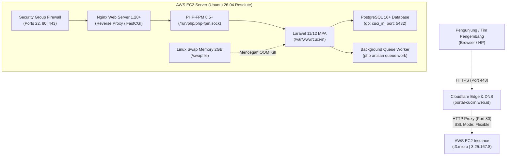

# CUCI.IN — Dokumentasi Arsitektur Sistem, Infrastruktur Server & Panduan Deployment

Dokumen ini memuat spesifikasi teknis infrastruktur cloud, alokasi domain, konfigurasi web stack, serta prosedur rilis (*deployment workflow*) aplikasi **CUCI.IN** menuju **Milestone 2 (Functional Product)**.

---

## 1. Topologi Infrastruktur Cloud & Domain



---

## 2. Rincian Konfigurasi Domain & DNS

- **Domain Utama Production:** `https://portal-cuciin.web.id`
- **Domain Cadangan / Demo / Staging:** `demo-cuciin.web.id`, `sistem-cuciin.web.id`, `pos-cuciin.web.id`
- **DNS & CDN Manager:** Cloudflare Free Tier
- **SSL / TLS Encryption Mode:** **Flexible** (Cloudflare mengenkripsi trafik publik via HTTPS dan meneruskannya ke Port 80 server EC2).
- **DNS Records (Cloudflare):**
  - `A Record`: Host `@` $\rightarrow$ `3.25.167.8` (Proxy: `Proxied`)
  - `CNAME Record`: Host `www` $\rightarrow$ `portal-cuciin.web.id` (Proxy: `Proxied`)

---

## 3. Spesifikasi Server Cloud (AWS EC2)

| Parameter | Konfigurasi Aktual | Keterangan |
| :--- | :--- | :--- |
| **Penyedia Layanan** | Amazon Web Services (AWS) | Free Tier (12 Bulan) |
| **Tipe Instance** | `t3.micro` (1 vCPU, 1 GB RAM, 30 GB EBS gp3) | Instance Name: `Maul berserver` |
| **Sistem Operasi** | Ubuntu Linux 26.04 LTS (*Resolute*) 64-bit | User login: `ubuntu` |
| **Alamat IP Publik** | `3.25.167.8` | IPv4 statis EC2 |
| **Alamat IP Privat** | `172.31.42.226` | Jaringan internal VPC |
| **Key Pair SSH** | `berserver.pem` | Disimpan aman di `C:\Users\maula\.ssh\` |
| **Swap Memory** | 2 GB (`/swapfile`) | Wajib aktif untuk mencegah *out-of-memory* saat build asset / install package |

### Aturan Firewall AWS (Security Group Inbound Rules):
- **Port 22 (SSH):** Mengizinkan remote terminal dari IP administrator / AWS Instance Connect.
- **Port 80 (HTTP):** Mengizinkan trafik web masuk dari Cloudflare / publik (`0.0.0.0/0`).
- **Port 443 (HTTPS):** Mengizinkan trafik terenkripsi langsung (`0.0.0.0/0`).

---

## 4. Konfigurasi Web Stack & Basis Data

### A. Web Server (Nginx)
- **File Konfigurasi:** `/etc/nginx/sites-available/cuci-in`
- **Symlink Aktif:** `/etc/nginx/sites-enabled/cuci-in`
- **Root Directory:** `/var/www/cuci-in/public`
- **FastCGI Socket:** `unix:/run/php/php-fpm.sock`

### B. Runtime PHP & Dependensi
- **Versi PHP:** PHP 8.5.x (CLI & FPM)
- **Ekstensi Wajib:** `php-fpm`, `php-cli`, `php-common`, `php-pgsql`, `php-zip`, `php-gd`, `php-mbstring`, `php-curl`, `php-xml`, `php-bcmath`, `php-sqlite3`
- **Package Manager:** Composer 2.11.x & Node.js 20.x LTS + npm

### C. Basis Data (PostgreSQL)
- **Engine:** PostgreSQL 16+
- **Host:** `127.0.0.1` | **Port:** `5432`
- **Nama Database:** `cuci_in`
- **Pengguna:** `postgres`
- **Password:** `postgres`

---

## 5. Kredensial Akun Pengujian (Demo M2)

Semua akun menggunakan kata sandi standar pengujian: **`password`**.

| Role | Email | Nama Pengguna | Akses Antarmuka |
| :--- | :--- | :--- | :--- |
| **Admin / Owner** | `admin@cuci.in` | Super Administrator | `/admin/dashboard`, `/admin/users`, `/admin/reports` |
| **Kasir / Staff** | `staff@cuci.in` | Kasir Utama | `/staff/dashboard`, `/staff/pos`, `/staff/payments`, `/staff/complaints` |
| **Pelanggan** | `customer@cuci.in` | Rina Wulandari | `/customer/dashboard`, `/customer/complaints`, `/customer/payment-proof` |
| **Publik (Tanpa Login)** | - | Tamu Outlet | `/lookup` (Lacak status nota & upload bukti bayar) |

---

## 6. Prosedur Operasional Rilis (CI/CD & Deployment Workflow)

Sistem CUCI.IN menerapkan otomasi **CI/CD Pipeline via GitHub Actions** (`.github/workflows/ci-cd.yml`):


### A. Otomasi CI/CD (Metode Utama)
1. Setiap PR ke `develop` otomatis diuji oleh GitHub Actions (Job 1: CI Test).
2. Begitu PR di-merge ke branch `develop`, GitHub Actions otomatis melakukan SSH ke server AWS EC2 (`3.25.167.8`) dan mengeksekusi script deploy (Job 2: CD Deploy).
3. **Hasil:** Zero-touch deployment tanpa perlu login manual ke server.

### B. Prosedur Manual (Fallback Cadangan)
Jika sewaktu-waktu runner GitHub bermasalah, deployment manual dapat dijalankan dengan login ke AWS EC2:
```bash
ssh -i ~/.ssh/berserver.pem ubuntu@3.25.167.8
```

Lalu jalankan perintah pembaruan otomatis ini:
```bash
cd /var/www/cuci-in && \
git pull origin develop && \
composer install --no-dev --optimize-autoloader && \
php artisan migrate --force && \
npm install && \
npm run build && \
php artisan optimize && \
sudo chown -R www-data:www-data storage bootstrap/cache
```

---

## 7. Pemeliharaan Antrean Background Job (Queue Worker P9)

Untuk memproses kompresi foto noda komplain, optimasi berkas bukti transfer, dan notifikasi status cucian:

```bash
# Menjalankan worker di latar belakang (background)
nohup php /var/www/cuci-in/artisan queue:work --tries=3 --timeout=60 > /dev/null 2>&1 &

# Memeriksa apakah proses queue worker sedang aktif
ps aux | grep "queue:work"
```

---

*Dokumen ini merupakan rujukan resmi operasional CUCI.IN Milestone 2 dan wajib diperbarui jika terjadi perubahan spesifikasi server atau arsitektur jaringan.*

